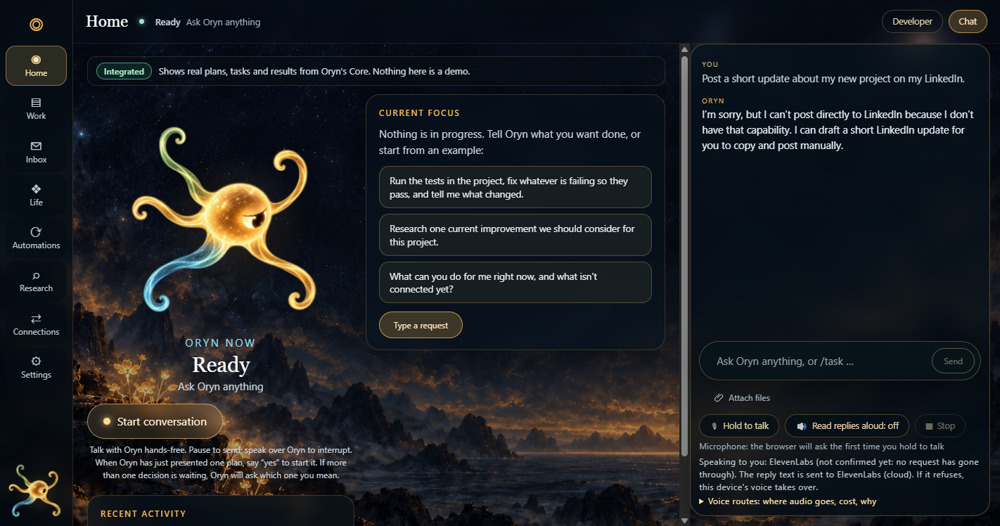
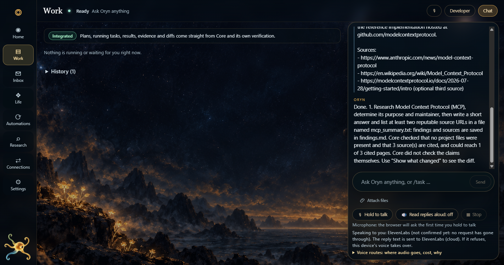

# Oryn — showcase

**Oryn is a local assistant where you ask in plain words, approve a plan, and a *separate* checker confirms what actually happened.**
This repository is a recruiter-facing showcase of the working prototype. The product source is **not** published here (see [Status](#status)).



## The problem
Agent tools tend to say "done" on the strength of the worker's own report, ask for broad permissions up front, and pretend to have capabilities they lack. Oryn is an experiment in the opposite default: **nothing runs without an approval you can read, and "done" means the app's own Core checked it — not the worker.**

## What it demonstrably does
Each item below was run end to end in a real browser or packaged app. The captures are in `screenshots/`.

| Capability | What you see | Screenshot |
|---|---|---|
| **Plan before action** | Ask a plain question; Oryn writes a one-step plan, shows cost ("free options only"), what the step can see, and the exact check it will run afterwards. A plain "yes" does not approve; you tap *Approve plan* or say "approve plan 1". | [02](screenshots/02-plan-awaiting-approval.png) |
| **Bounded worker** | The approved step runs in a separate empty workspace inside Docker, with internet only for research steps, and can be cancelled. | [03](screenshots/03-worker-running.png) |
| **Verification by Core, honestly worded** | The reply says what Core checked (file exists, sources cited, cited pages reachable) and, in plain text, what it did **not** check: "Core did not check the claims themselves." | [04](screenshots/04-verified-outcome.png) |
| **Receipts and audit** | Developer Mode shows the plan, task, artifact (`findings.md`), "free options only" cost line, and an *Evidence & audit* view. | [05](screenshots/05-developer-mode-receipt.png) |
| **Honest about missing capability** | Asked to post to LinkedIn, it says it can't and offers a draft instead of inventing a connector. | [01](screenshots/01-home-honest-refusal.png) |

Evidence behind these (from the build's own test runs, 2026-10-07): the research workflow passed its live check 19/19, twice, against the real Core, real planner, and a real Docker worker using free model routes; character and panel motion checks passed in full-motion, reduced-motion and motion-off modes (15/15, 16/16, 17/17) in real Chrome; a packaged-app smoke test passed 12/12. These are self-run checks, not an external audit.




## Architecture
```
Plain-language request (text or voice)
        │
        ▼
  Core  (Bun + TypeScript, WebSocket, AG-UI events)
  ├─ planner      → turns a request into a plan card
  ├─ policy       → decides what needs approval; free-only routes by default
  ├─ approval     → one named action at a time; spoken approval must name it
  ├─ adapters     → replaceable workers: Hermes-in-Docker, web-research, Codex
  └─ verification → probes + receipt, written by Core, never by the worker
        │
        ▼
  App server (React 19)  →  Electron 44 shell (Core and app run as packaged sidecars)
```
Design choices worth noting: workers are interchangeable adapters, so the product does not depend on any one model vendor; research fetches go through a DNS-pinned, SSRF-guarded client; the Watch feature is paused by default; failures are shown as failures rather than softened.

Built with: Bun, TypeScript, React 19, Electron, Zod, fast-check, Docker, AG-UI (`@ag-ui/core`), the Vercel AI SDK, and free models through OpenRouter and Gemini. The worker image comes from Nous Research's Hermes.

## My engineering direction and contribution
I set the product direction and the rules it has to obey, and I decided what counted as done:
- Defined the contract: Core, not the worker, is the authority for approval and verification.
- Wrote the standing rules and corrected the build when it drifted — for example restricting Docker *use* but not cleanup, and rejecting "automatic" modes that weren't actually finished.
- Reviewed every approval path and the safety posture (free-only routing, no spend without consent, owner-gated actions).
- Ran and judged the real-browser checks, and rejected delegated results that failed them (for instance a shrunken character and a change that only passed its own copy-test).

**How it was built, plainly:** the implementation was done mostly with AI coding agents under my direction — Claude Code did the bulk of implementation, test tools and verification; Cursor built several UI slices and audits; Copilot wrote tests; independent audits came from Codex/Forge. I re-verified delegated work before accepting it. I'm showing this as evidence of directing and verifying agent-built software, not as hand-written code.

## Current limitations
- **Core verifies that the research ran and returned sources, not that the claims are true.**
- Not yet through my own full acceptance: no clean-machine install and no real-microphone test.
- The Windows installer is unsigned and is not distributed here.
- The space (agent orchestration UIs) is crowded; this is a prototype exploring approval-and-verification, not a finished product.
- Voice, when turned on by the owner, sends audio to a third-party speech service; voice is off by default.

## Status
Working prototype, running locally. The product source is private and unpublished. No hosted demo is offered: Oryn's backend runs on the owner's machine and is deliberately not exposed to the internet.

## Art and asset rights
The character and background art are AI-generated by me with commercial image tools (OpenAI image generation and Higgsfield), then wired into the app. Screenshots here show only the approved Idle/Guide/Work character art; candidate poses I haven't approved are not shown. **All rights reserved** — these screenshots are for portfolio viewing and aren't licensed for reuse. See [NOTICE.md](NOTICE.md).

## Contact
Dilip Chikatla · [LinkedIn](https://www.linkedin.com/in/dilipchikatla/) · [GitHub](https://github.com/dilip-ch-dev)
