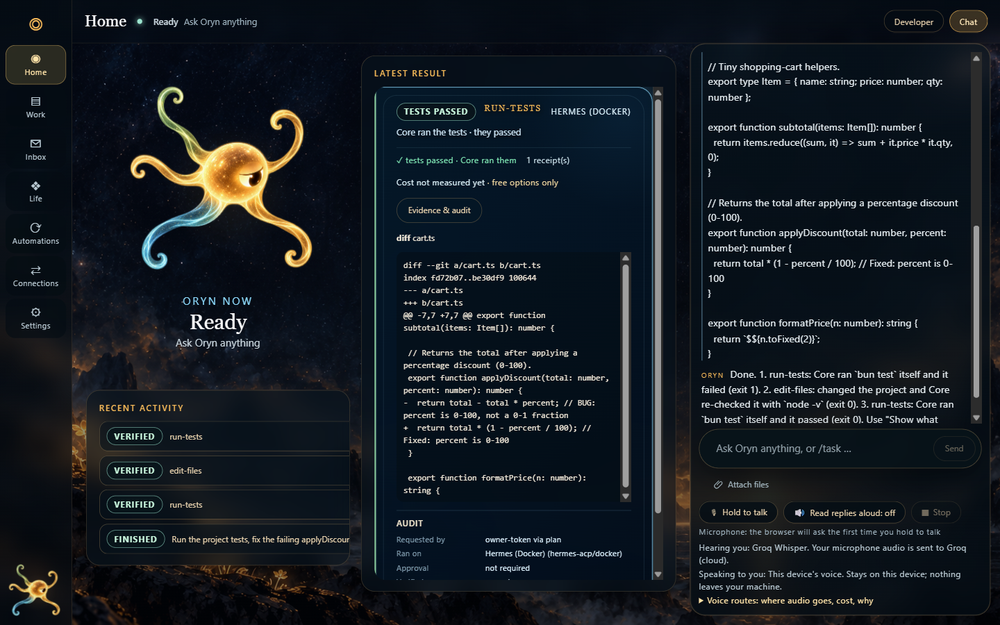
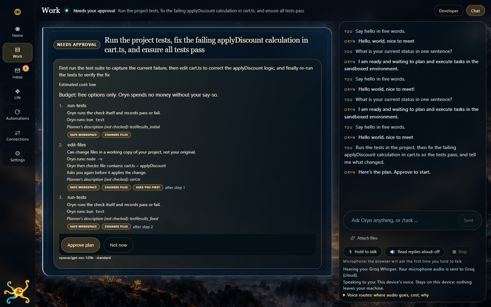
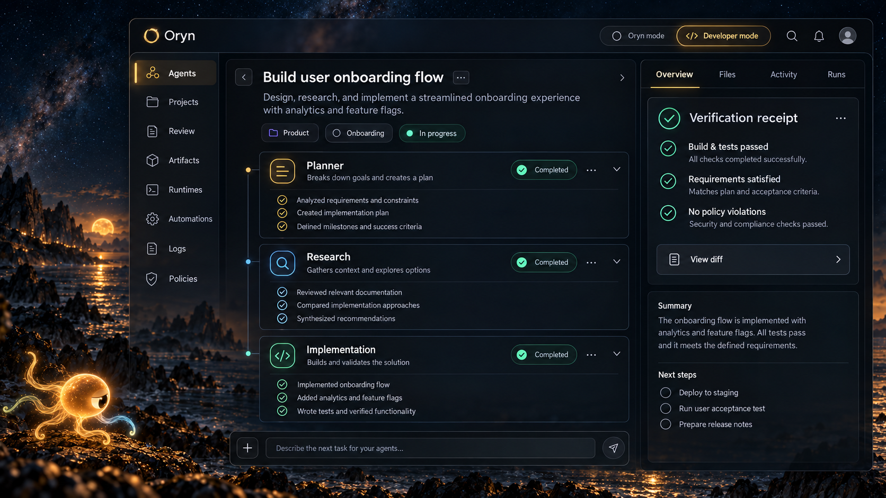

# Oryn — clarity into action

**Oryn is a visual AI workspace that turns a plain request into a clear plan, real work, and results you can open and inspect.** Conversation and task execution live in one place, with visible progress and replaceable workers behind the scenes.



## What Oryn helps you do
- **Say what you want in plain words**, by typing or speaking.
- **See the plan before anything happens.** Every step is written out: what it will do, whether it touches files or the internet, what it costs, and how the result will be checked.
- **Get real work done.** Research a question and get a short answer with named sources. Run a project's tests, fix what fails, and run them again.
- **Open the result.** See the code diff, the files produced, a receipt for each step, and an audit trail of what ran and where.

## One request, start to finish
> *"Run the tests in the project, fix the failing applyDiscount calculation, and tell me what changed."*

**1. Plan.** Oryn writes a three-step plan: run the tests, edit the file, run the tests again. Each step is labelled (safe workspace, changes files, asks you first), and the cost is shown.



**2. Work.** After you approve, a worker carries out the steps in a safe copy of your project, not your original.

**3. Result.** Oryn runs the checks itself and shows the outcome: tests passed, the diff of what changed, and a receipt. The home screen above is that result, with recent activity listed underneath.

Research works the same way: ask a plain question, approve the plan, and get a short answer with its sources and a findings file.

## How it is built
```
Plain-language request (text or voice)
        │
        ▼
  Core  (Bun + TypeScript, WebSocket, AG-UI events)
  ├─ planner      → turns a request into a plan card
  ├─ policy       → classifies each step; free model routes by default
  ├─ approval     → plan-approved steps; a plain "yes" does not approve
  ├─ adapters     → replaceable workers: Hermes-in-Docker, web research, Codex
  └─ verification → checks and receipts written by Core
        │
        ▼
  App server (React 19)  →  Electron shell (Core and app run as packaged sidecars)
```
Engineering decisions behind it:
- **Replaceable workers.** Workers sit behind one contract, so Oryn is not tied to a single model vendor.
- **Independent checking.** Core runs the checks and writes the receipt, so "tests passed" is something Oryn confirmed itself.
- **Safe by default.** Work runs in an isolated workspace, web fetches use an SSRF-guarded client, and spending is off unless you allow it.
- **An honest status model.** Each feature is graded Integrated, Working with limits, Configured, Researched, or Unavailable.

Stack: Bun, TypeScript, React 19, Electron, Zod, fast-check, Docker, AG-UI, Vercel AI SDK, free models via OpenRouter and Gemini; worker image from Nous Research's Hermes.

## Direction
Oryn is heading toward a more personal, proactive assistant: one that understands your ongoing goals, uses the tools and accounts you choose to connect, brings the right decision to you at the right moment, and coordinates several helpers across longer projects.


*Design concept (AI-generated). This is a direction, not a screenshot of the running app.*

On the roadmap: a personalized daily home, proactive suggestions, scheduled and recurring work, connected email, calendar and other accounts (with your approval), and multi-helper project views.

## Development status
Oryn is a working prototype on Windows that runs locally.
- **Demonstrated:** plain-language research with sources (live check passed 19/19, run twice) and an approved coding task with a verified diff, plus a packaged-app smoke test (12/12). These are self-run checks.
- **Next:** a clean-machine install test, voice polish, more connected tools, and fact-checking of research answers (today Core confirms the research ran and returned sources).
- Source is private and there is no hosted demo yet.

Dilip Chikatla · [LinkedIn](https://www.linkedin.com/in/dilipchikatla/) · [GitHub](https://github.com/dilip-ch-dev)

*Screenshots and art are for viewing only; all rights reserved (see [NOTICE.md](NOTICE.md)).*
